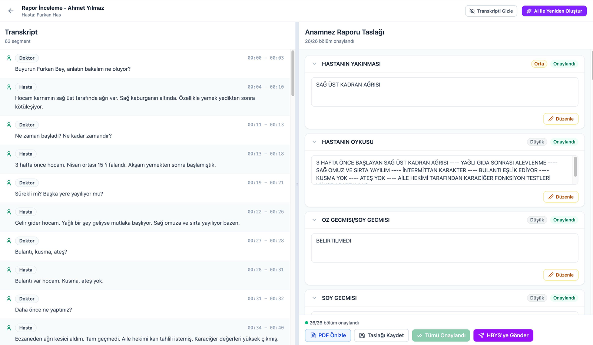
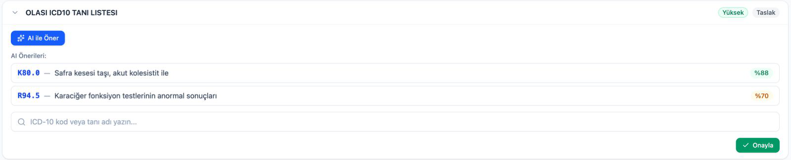
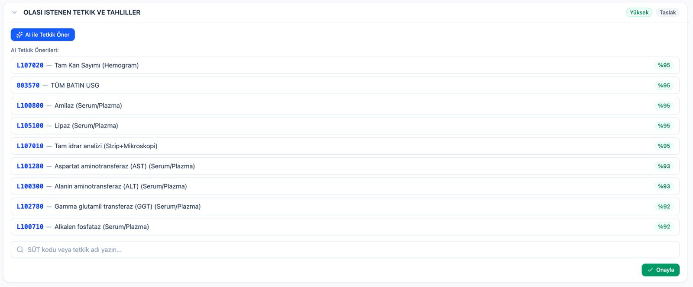
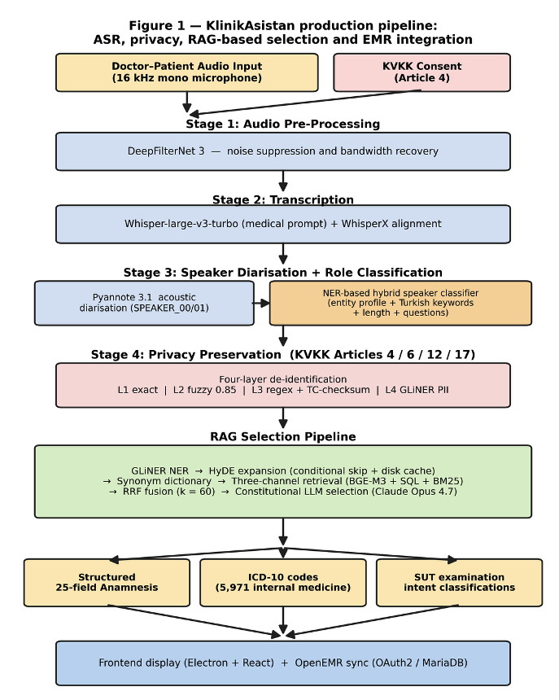
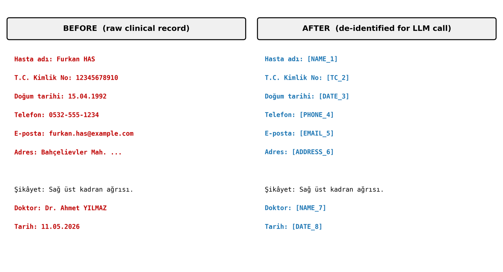
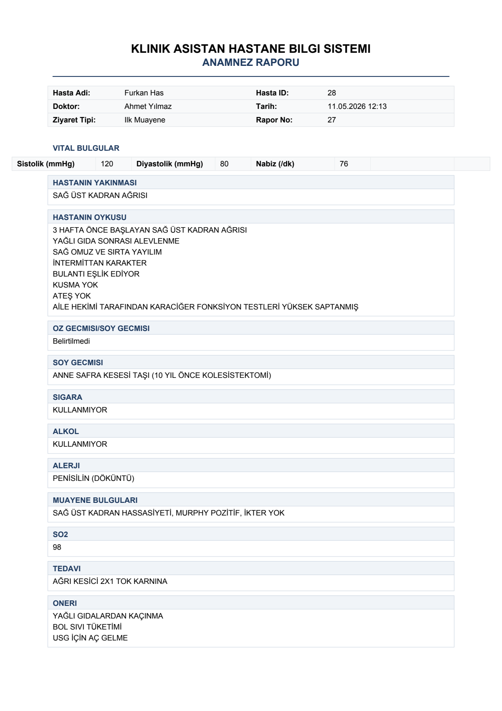
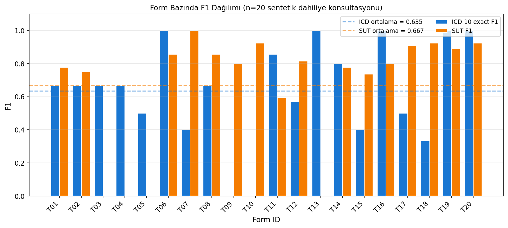
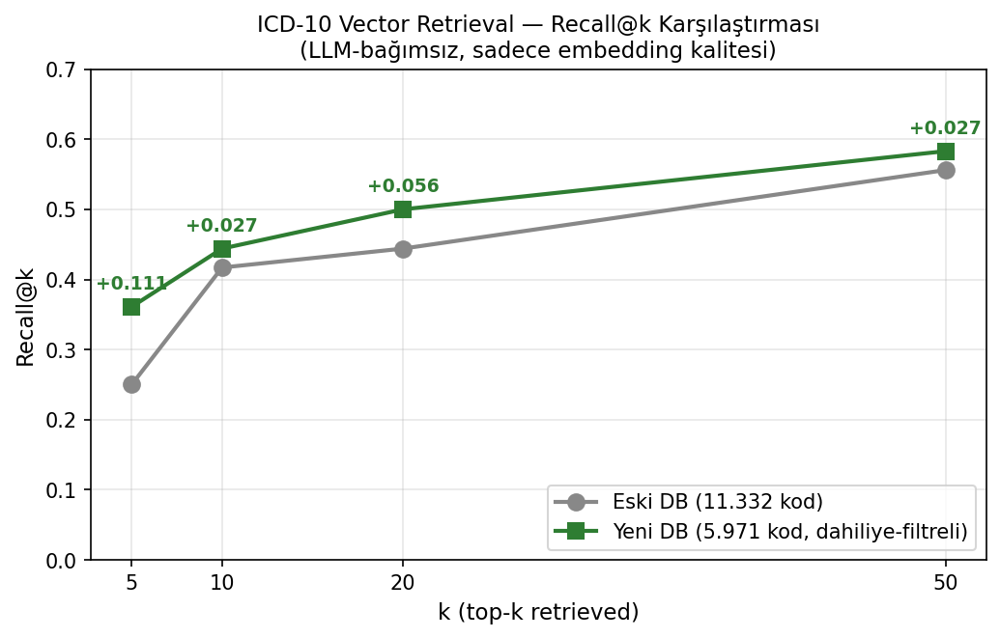
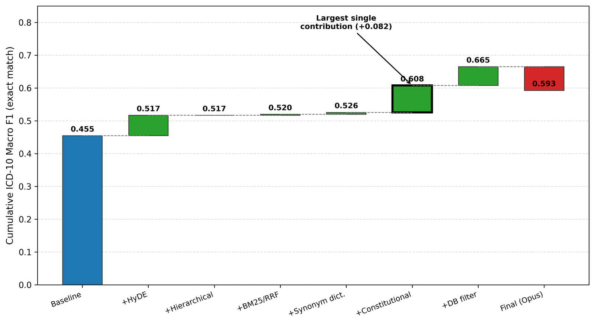

# Doctor AI Assistant (KlinikAsistan)

**English** · [Türkçe](README.tr.md)

Desktop application for AI-assisted medical documentation in Turkish polyclinics.
It records the doctor–patient consultation, transcribes it, separates the speakers,
and uses a large language model (LLM) to produce a structured **anamnesis**,
**ICD-10 diagnosis codes** and **SUT lab/imaging test** suggestions. The doctor
reviews and approves the draft, and the result can be sent to OpenEMR (HIS).

> Capstone project — Kadir Has University, Computer Engineering (team of four).
> Clinical use with real patient data requires a separate KVKK/GDPR and regulatory review.

> **About the data:** The de-identified hospital reports used during development,
> the anamnesis database / ChromaDB indexes built from them, and evaluation outputs
> are **not included** in this repository (KVKK). The repository contains the
> scripts to rebuild the indexes from your own data; without data the app runs
> with anamnesis RAG disabled.

## Screenshots

> Patient and doctor details in the screenshots are fictional demo data. The UI is in Turkish.

**Report review:** speaker-separated transcript (left), the 25-field anamnesis
draft generated by the LLM (right), doctor approval and sending to the HIS.



| ICD-10 diagnosis suggestions | SUT test suggestions |
|---|---|
|  |  |

| Pipeline | KVKK: four-layer de-identification |
|---|---|
|  |  |

<details>
<summary>Generated anamnesis report (PDF output)</summary>


</details>

## Results

End-to-end evaluation on 20 synthetic internal-medicine consultations
(mean ICD-10 exact-match F1 **0.635**, mean SUT test F1 **0.667**), and the
Recall@k gain of the internal-medicine-filtered ICD-10 vector database:

<p>
  
</p>
<p>
  
</p>

Contribution of each step to ICD-10 macro F1 in the ablation study (baseline 0.455 → 0.665):



Detailed ablation reports (Turkish): `docs/`.

---

## Features

- **ASR (speech → text):** batch transcription with `faster-whisper`, speaker
  diarization with `pyannote.audio`, noise suppression with `DeepFilterNet`.
- **LLM anamnesis generation:** a 25-field structured anamnesis (JSON) in a single
  LLM call. Default model: **Anthropic Claude Haiku 4.5**.
- **RAG:** context retrieval from de-identified real hospital reports via BGE-M3
  embeddings + ChromaDB.
- **ICD-10 coding:** NER → semantic vector search → LLM *selection* (not generation)
  over 11,332 Turkish ICD-10 codes.
- **SUT test suggestions:** extracts lab/imaging requests from the conversation with
  intent analysis.
- **Privacy:** four-layer de-identification (exact, fuzzy, regex + TC-checksum,
  GLiNER PII) before any LLM call.
- **OpenEMR (HIS) integration:** OAuth2 REST API and direct MariaDB queries.
- **PDF reports** with `reportlab`.
- **Desktop UI:** Electron + React, fully Turkish interface.

## Architecture

```
┌─────────────────────────┐         ┌──────────────────────────────┐
│   Frontend (Electron)   │         │      Backend (FastAPI)        │
│  React 19 + TypeScript  │◀───────▶│      Python 3.11              │
│                         │  WS /   │                               │
│  - Audio recording      │  SSE /  │  - ASR pipeline               │
│  - Consultation screen  │  REST   │  - LLM services               │
│  - Report review        │         │  - RAG / ICD-10 / SUT         │
└─────────────────────────┘         │  - OpenEMR integration        │
                                    └───────────────┬───────────────┘
                                                    │
                            ┌───────────────────────┼───────────────────┐
                            ▼                       ▼                   ▼
                     SQLite / MariaDB         ChromaDB (vectors)    OpenEMR (HIS)
                     (sessions, users,        (anamnesis RAG,       OAuth2 + MariaDB
                      reports, ICD-10)         ICD-10 search)
```

- **Communication:** WebSocket (audio/transcription), SSE (LLM streaming), REST (CRUD)
- **API contract:** `shared/api-spec.json` — single source of truth for both layers
- **Operational database:** SQLite by default (`data/asr.db`); MariaDB for team setups

## Tech stack

| Layer | Technologies |
|---|---|
| Backend | Python 3.11, FastAPI, Uvicorn, SSE, SQLAlchemy 2, Pydantic 2 |
| ASR | faster-whisper, pyannote.audio, DeepFilterNet, FFmpeg |
| NLP / ML | PyTorch, transformers, sentence-transformers, GLiNER, ONNX Runtime |
| Retrieval | ChromaDB, BGE-M3, BM25, RRF fusion, HyDE |
| LLM providers | Anthropic Claude (default), Gemini, Groq, Cerebras, OpenRouter, Ollama |
| Frontend | Electron 39, React 19, TypeScript 5.9, electron-vite, Tailwind 4, Zustand, React Query |
| Integration | OpenEMR (OAuth2 REST + MariaDB), Docker Compose |

## Getting started

**Prerequisites:** Python 3.11, Node.js 20+, FFmpeg on `PATH`; optionally Docker
(MariaDB + OpenEMR) and a CUDA GPU. API keys: Anthropic (LLM) and a Hugging Face
token (`HF_TOKEN`, for pyannote models).

```bash
git clone https://github.com/Elifglm/Doctor-AI-Assistant.git
cd Doctor-AI-Assistant

# Backend (conda recommended)
conda env create -f environment.yml && conda activate asr
#   or: python3.11 -m venv .venv && source .venv/bin/activate
#       pip install torch torchaudio            # install PyTorch first (CPU or CUDA build)
#       pip install -r requirements-docker-base.txt -r apps/backend/requirements.txt

cp .env.example .env     # set ASR_LLM__ANTHROPIC_API_KEY, HF_TOKEN
                         # without the anamnesis corpus also set ANAMNEZ_RAG_ENABLED=false

# ICD-10 database + vector index (once)
python -m apps.backend.src.scripts.import_icd10 docker/openemr/icd10_tr.sql
python -m apps.backend.src.scripts.build_icd10_vectors

# Run
uvicorn apps.backend.src.main:app --reload --host 127.0.0.1 --port 8700   # API docs: /docs
cd apps/frontend && npm install && npm run dev                            # Electron app
```

Docker (MariaDB + OpenEMR), OpenEMR OAuth setup and database dump import/export
are documented in [`docker/README.md`](docker/README.md) and the
[Turkish README](README.tr.md).

## Tests

```bash
pytest apps/backend/tests/ -v
cd apps/frontend && npm test
```

## Project structure

```
apps/backend/        FastAPI backend (asr/, rag/, routes/, services/, ws/)
apps/frontend/       Electron + React desktop app
src/, config/        Base ASR pipeline
shared/              API contract shared by both layers
docker/              MariaDB + OpenEMR init scripts
docs/                Research and evaluation reports
bench_data/          Synthetic consultation transcripts for benchmarks
scripts/             Helper scripts
```

## Team

Efe Türkyılmaz · Elif Gülüm · Muhammet Emir Gündoğdu · Mücahit Furkan Kapusuz

Advisors: Dr. Zeki Erdem, Dr. Rahim Dehkharghani
